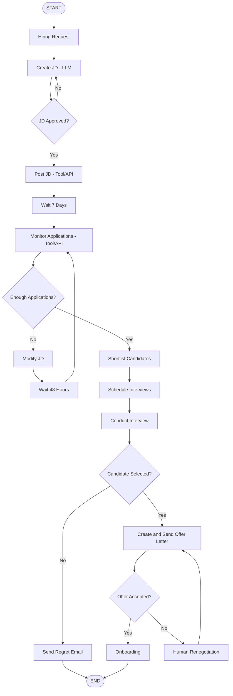
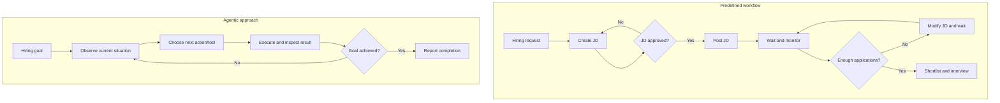
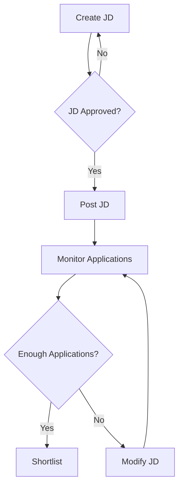

# Lecture 3 — LangChain vs LangGraph

## Part 1: Why LangGraph Exists, and How to Think About Its Workflow

## 1. LangChain Kya Hai?

**LangChain is an open-source framework that simplifies building LLM-based applications.** Matlab, jab humein LLM ko apni application ke andar use karna ho, toh har cheez scratch se connect karne ke bajaye LangChain ke reusable components use kar sakte hain.

For example, agar tum YouTube video ke content par questions answer karne wala app bana rahe ho, toh model call, prompt, relevant content retrieve karna, aur output format karna—yeh sab alag-alag pieces hain. LangChain in pieces ko organize aur connect karne mein help karta hai.

### Important building blocks

**1. Model**  
Model component ek common interface provide karta hai jisse supported providers ke LLMs ke saath interact kar sakte ho. Iska benefit yeh hai ki provider change karte waqt application ke har part ko rewrite karne ki zaroorat often kam ho jaati hai.

**2. Prompts**  
Prompt batata hai ki model ko kya task karna hai aur kis context ke basis par answer dena hai. Prompt templates mein dynamic values fill kar sakte ho.

**3. Retrievers**  
Retriever knowledge base ya vector store se query ke relevant document chunks laata hai. RAG mein yeh important hai because model ko answer generate karne se pehle useful context milta hai.

**4. Tools**  
Tools APIs ya Python functions ho sakte hain. Model weather tool choose kar sakta hai, but actual current weather tool/API se aata hai—not model ki internal knowledge se.

**5. Chains**  
Chain components ko connect karti hai. Ek component ka output next component ka input ban sakta hai, without manually passing every output yourself.

```text
User input
    |
    v
Prompt template
    |
    v
LLM
    |
    v
Output parser
    |
    v
Final answer
```

For example, user topic deta hai → LLM detailed report banata hai → second prompt us report ko summarize karwata hai → summary user ko milti hai. Yeh **linear multi-step workflow** hai, aur chains is tarah ke flows ke liye convenient hain.

LangChain sirf chains tak limited nahi hai; it also supports tool-using agents. Main question yeh hai: **jab application ka control flow complex ho jaaye, toh orchestration ko kaise organize karein?**

---

## 2. Automated Hiring: Ek Realistic Example

Imagine recruiter tumhare application ko request deta hai:

> “We need a remote backend engineer with 2–4 years of experience.”

Application ka goal sirf job description likhna nahi. It should coordinate the hiring process—from JD creation to onboarding. Isko samajhne ke liye pehle developer ke perspective se ek fixed workflow design karte hain.

## 3. Complete Hiring Flowchart



Ab is diagram ko sirf dekh kar aage mat badho. Iska main point hai ki hiring ek single straight line nahi hai—multiple decisions aur loops hain.

## 4. Flowchart Ko Step-by-Step Samjho

### Step 1 — Hiring request

Recruiter role, experience range, work mode, aur requirements deta hai. Ye initial input hai jiske basis par next steps operate karenge.

### Step 2 — Create JD using an LLM

System hiring request ko prompt mein daalta hai and asks the LLM to draft a job description. LLM text create karta hai; it does not automatically mean the JD is correct or approved.

**Example of the idea—not a complete implementation:**

```python
hiring_request = "Remote backend engineer, 2-4 years experience"

# Conceptually, this request is sent to an LLM with an instruction:
# "Create a job description based on this hiring request."
job_description = llm.invoke(hiring_request)
```

Yahan `llm` sirf placeholder hai. Actual app mein model configuration, prompt template, validation, and error handling bhi chahiye. Abhi code ka purpose bas yeh dikhana hai ki JD creation is an LLM task.

### Step 3 — JD approval loop

Generated JD human supervisor ko dikhayi jaati hai.

- **No:** supervisor changes maangta hai; system JD revise/recreate karke approval dobara leta hai.
- **Yes:** JD job platform par post hoti hai.

Isliye flowchart mein `JD Approved?` se `Create JD` tak backward arrow hai. Jab tak approval nahi milta, system review cycle mein rehta hai.

### Step 4 — Post JD using a tool/API

Approval ke baad system LinkedIn ya kisi job platform ki API/integration use karke JD publish karta hai. Important distinction: **LLM content draft karta hai; tool external platform par action perform karta hai.**

### Step 5 — Wait 7 days, then monitor applications

Job post hote hi applications check karna useful nahi hoga. Workflow seven days wait karta hai, phir job-platform API se application count retrieve karta hai.

Assume minimum threshold **20 applications** hai. Yeh threshold business logic hai; API current count laati hai.

### Step 6 — Enough applications? Decision

- **Yes (20 or more):** system shortlisting par jaata hai.
- **No (less than 20):** JD modify karta hai, waits 48 hours, and checks applications again.

Example: first check par 10 applications aaye, so system JD revise karega. Next 48-hour check par 15 aaye, toh modification-monitoring cycle repeat ho sakti hai. Agar baad mein 25 applications ho gaye, system shortlisting par jaayega.

This is the second major loop:

```text
Monitor applications
        |
        v
Enough applications?
   | Yes          | No
   v              v
Shortlist      Modify JD
                  |
              Wait 48 hours
                  |
                  +----> Monitor applications again
```

Production system mein sensible stopping condition ya human escalation bhi define karni chahiye; otherwise this loop could continue indefinitely.

### Step 7 — Shortlist candidates

System resumes collect/download and parse karta hai. Then candidates ko job requirements ke against evaluate kiya jaata hai. LLM summaries ya evidence extraction mein help kar sakta hai, but hiring criteria clear hone chahiye and consequential decisions should have appropriate human oversight.

### Step 8 — Schedule and conduct interviews

Calendar integration interviewer availability check kar sakti hai, aur email tool candidates ko invitations bhej sakta hai. Interview ke baad har candidate ke liye selection outcome record hota hai.

- **Not selected:** regret email bhejo; that candidate's path ends.
- **Selected:** offer-letter stage par jao.

### Step 9 — Offer acceptance and renegotiation loop

Offer letter generate kiya ja sakta hai, then email tool se send kiya jaata hai. System candidate ke response ka wait karta hai.

- **Accepted:** onboarding start.
- **Not accepted:** human recruiter terms negotiate karta hai. Revised offer bheja jaata hai and acceptance dobara check hoti hai.

```text
Send offer letter
        |
        v
Offer accepted?
   | Yes          | No
   v              v
Onboarding    Human renegotiation
                  |
                  +----> Send revised offer
```

Yeh third loop hai. Renegotiation human handle karta hai because compensation and employment terms consequential decisions hain.

### Step 10 — Onboarding and END

Acceptance ke baad HR system ke through welcome email, equipment provisioning, aur knowledge-transfer session jaise tasks trigger ho sakte hain. Workflow then reaches END.

### Which steps use what?

| Part of process | Main mechanism |
|---|---|
| Create JD | LLM |
| Approve JD | Human decision |
| Post JD / monitor count | Job-platform tools or APIs |
| Shortlist | Resume parser + evaluation logic, possibly LLM support |
| Schedule interview | Calendar and email tools |
| Candidate selection | Human decision / recorded result |
| Offer letter | LLM may draft; email tool sends |
| Renegotiation | Human |
| Onboarding | HR-system integrations/tools |

So this is not “an LLM doing everything.” It is a coordinated application containing LLM calls, tools, conditions, waiting, and human decisions.

---

## 5. Workflow vs Agent — The Critical Difference

Yeh distinction samajhna important hai because the flowchart above is a **workflow**, not automatically an agent.

### Predefined workflow

Developer pehle se steps aur routing rules decide karta hai. In our hiring example, we have already specified what happens if the JD is rejected, if applications are too few, or if the offer is declined.

The path can branch, and it can loop, but the rules for those branches were defined by the developer.

### Agent

An agent gets a goal and can dynamically choose its next action/tool based on the current situation and its observations, within its permissions. For example, low application volume dekhkar it might investigate salary competitiveness, compare similar job posts, or recommend changing the experience requirement—depending on its reasoning and available tools.



**Core distinction:** workflow mein developer route define karta hai; agent can choose its route dynamically. Dono LLMs aur tools use kar sakte hain. Difference yeh nahi hai ki workflow mein decisions nahi hote—difference hai ki decision logic predefined hai ya agent dynamically select kar raha hai.

---

## 6. Why Does This Become Difficult with Long Chains?

A linear chain is like a conveyor belt: one stage completes, then the next begins. Hiring workflow, however, behaves like a road network with junctions, backward routes, and pauses.

Three things make control flow non-linear:

1. **Conditional branches:** approved/rejected, enough/not enough applications, selected/not selected, accepted/not accepted.
2. **Loops:** JD review loop, application monitoring loop, offer renegotiation loop.
3. **Jumps and delays:** after seven days or 48 hours, execution must resume at the correct point.

LangChain chains are convenient for connecting components in sequence. But if we build a complex process by surrounding chains with many custom Python `if` statements, loops, callbacks, and state updates, the code accumulates **glue code**—custom code whose job is to connect and control the pieces.

A little glue code is normal. The problem is when orchestration becomes scattered across the application: it becomes harder to maintain, debug, extend, and understand where execution should go next.

## 7. How LangGraph Models the Same Workflow

LangGraph represents a workflow as a graph that the framework can execute. Graph ka matlab yahan nodes aur unke beech connections ka structure hai. Har node ek task perform karta hai, aur edges decide karte hain ki execution next kahan jaayega.

### Example: Hiring workflow ka small graph



Is graph mein JD approval aur application monitoring ke decisions hain. Notice karo ki kuch arrows aage jaate hain, while others previous task par return karte hain. Ab in connections ko samajhte hain.

### 1. Node — What work needs to happen?

Node represents one task in the workflow, usually implemented as a Python function.

Examples:

- `create_jd` — LLM se job description generate karwana.
- `post_jd` — job platform par JD publish karna.
- `monitor_applications` — current application count check karna.
- `shortlist` — suitable candidates shortlist karna.

Simple words mein, node ka kaam hai kuch perform karna. Graph ke andar har task ko alag node rakhne se workflow samajhna aur modify karna easier ho jaata hai.

### 2. Edge — Where does execution go next?

An edge connects one node to another and defines the next step.

For example:

`Create JD → JD Approved? → Post JD`

Approval ke baad `Post JD` tak jaane wala arrow ek edge represent karta hai. Edge basically graph ko batata hai ki ek task ke baad execution kis task ki taraf move karega.

### 3. Conditional Edge — Which route should be followed?

A conditional edge chooses the next node based on a condition or the current state. Yaani next step har baar same nahi hoga; decision ke result ke according route change hoga.

Hiring example mein:

- `JD Approved?` → Yes: `Post JD`; No: `Create JD` again.
- `Enough Applications?` → Yes: `Shortlist`; No: `Modify JD`.

Condition ka result route decide karta hai. LangGraph mein routing function current state ko check karke next node ka naam return kar sakta hai.

### 4. Cycle — How does the workflow repeat a step?

A cycle is a path that returns to an earlier node, allowing the workflow to repeat some work.

Graph mein do cycles dekho:

- JD approval loop: `Create JD → Approval → No → Create JD`
- Application loop: `Monitor → Not enough applications → Modify JD → Monitor`

Suppose first check par only 12 applications aaye, jabki target 20 hai. Workflow JD modify karega, 48 hours wait karega, and then applications dobara check karega. Enough applications aane tak cycle repeat ho sakti hai.

### Why does this matter?

Agar hum poora process ek long chain mein implement karein, toh repeated steps aur multiple `if/else` conditions ko connect karne ke liye kaafi custom Python code likhna pad sakta hai. Is extra connecting code ko often glue code kehte hain.

LangGraph mein nodes, edges, conditional routing aur cycles graph structure mein explicitly define hote hain. Isse complex workflow ka control flow dekhna, samajhna aur maintain karna easier ho jaata hai.