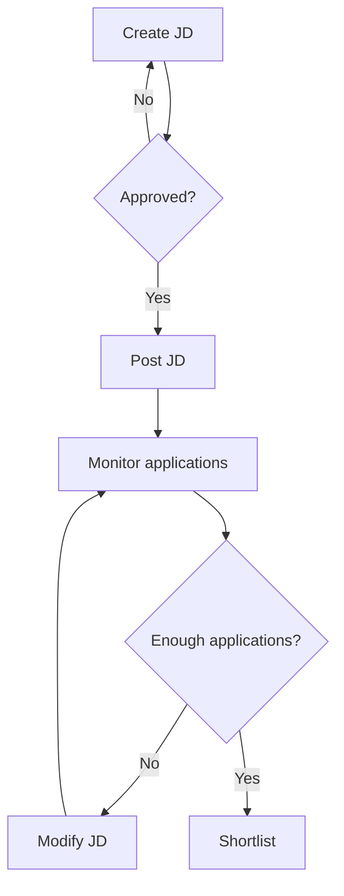
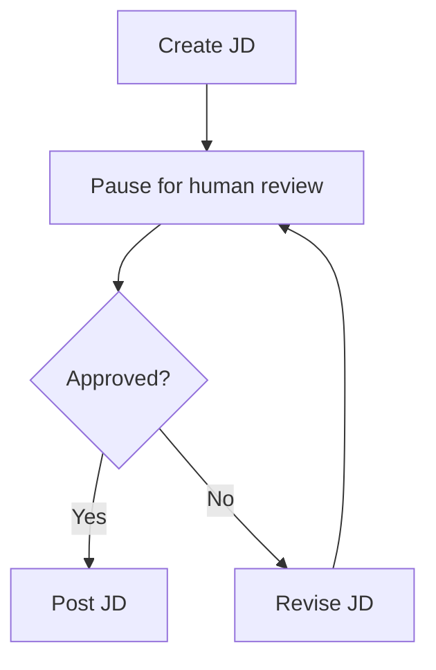

# Lecture 3 — LangChain vs LangGraph

## Part 2: The Challenges of Building Complex Workflows with LangChain

Part 1 mein humne samjha ki hiring process jaise complex workflow mein branching, loops, state tracking, failure recovery aur human approval ki zaroorat hoti hai. LangChain se yeh sab custom code ke through manage kar sakte hain, lekin workflow complex hone par code ko maintain aur debug karna difficult ho jata hai.

Yahin LangGraph help karta hai. Is part mein hum dekhenge ki graph-based orchestration se in challenges ko kaise manage kiya ja sakta hai, while LangChain ke models, prompts aur tools jaise components ka use continue rehta hai.

Aage hum LangChain vs LangGraph ke practical use cases bhi compare kar sakte hain.  Practical comparison

## 1. Challenge: Complex Control Flow

**Control flow** means deciding which step runs next.

A simple chain works well when the flow is mostly linear:

```text
Input → Prompt + LLM → Output parser → Answer
```

But hiring workflow mein multiple routes hain:

- JD rejected → create/revise JD again.
- Applications below threshold → modify JD, wait 48 hours, then monitor again.
- Candidate not selected → regret email.
- Offer declined → human renegotiation, then send a revised offer.

A chain itself is designed to connect components. If we use it as the foundation for a complex workflow, we may end up writing many Python `if/else` statements, loops, and custom functions to control the overall execution. This extra connecting logic is called **glue code**.

### How LangGraph helps

LangGraph models the workflow as a graph:

- **Nodes** represent tasks.
- **Edges** connect tasks.
- **Conditional edges** choose the next route.
- **Cycles** allow the flow to return to an earlier task.



Yeh structure control flow ko explicit banata hai. Instead of tracking many scattered branches in custom code, the possible paths are visible in the graph.

**High-level code idea — not full implementation:**

```python
builder.add_node("create_jd", create_jd)
builder.add_node("post_jd", post_jd)
builder.add_node("monitor", monitor_applications)

builder.add_edge("create_jd", "approval")
builder.add_conditional_edges("approval", route_after_approval)
```

Is snippet ka purpose sirf API ka shape dikhana hai: tasks ko nodes ke roop mein register karna, then edges/routing define karna. Hum implementation details baad mein cover karenge.

---

## 2. Challenge: State Handling

Complex workflow ko sirf steps hi nahi chahiye; it must also remember the information collected so far.

Hiring process mein possible state fields:

```json
{
  "job_description": "Draft JD...",
  "jd_approved": true,
  "jd_posted": true,
  "application_count": 14,
  "application_threshold": 20,
  "shortlisted_candidates": [],
  "offer_status": "not_started"
}
```

Suppose `application_count` is 14 and the threshold is 20. The workflow needs these values to decide whether to modify the JD or start shortlisting. Later nodes may need the approved JD, shortlisted candidates, interview schedule, or offer status.

### Why can this be awkward with chains?

A simple chain can pass one step's output to the next. But a long workflow may need many fields to be tracked and updated across multiple branches.

With a manual approach, you might maintain a shared Python dictionary, pass it around, and update the correct fields after every step. Jitna workflow complex hota hai, utna hi manual state management error-prone aur tedious ho sakta hai.

LangChain has conversational-memory options, but **conversation history and structured workflow state are not the same thing**. Chat messages store what was said; workflow state can store facts such as `application_count`, `jd_approved`, and `offer_status`.

### How LangGraph handles state

In LangGraph, a state schema defines the information available to graph nodes. Nodes receive the current state and return updates; LangGraph manages how these updates flow through execution.

**High-level example:**

```python
class HiringState(TypedDict):
    application_count: int
    application_threshold: int
    decision: str

def check_applications(state: HiringState):
    if state["application_count"] < state["application_threshold"]:
        return {"decision": "modify_jd"}
    return {"decision": "shortlist"}
```

Yahan node current state read karta hai, condition evaluate karta hai, and a small state update return karta hai. Full graph wiring and state-update behaviour ko implementation lesson mein detail se dekhenge.

---

## 3. Challenge: Event-Driven Execution

Workflows can execute in two broad ways.

### Sequential execution

One step completes and the next starts immediately:

```text
Step A → Step B → Step C → Step D
```

### Event-driven execution

Workflow kisi point par pause hota hai, an external event ka wait karta hai, then resumes:

```text
Step A → Save progress → PAUSE
                           |
                    External event
                           |
                           v
                    Resume workflow
                           |
                           v
                        Step B
```

Hiring workflow mein iski clear examples hain:

- JD post karne ke baad **7 days** wait karna.
- JD modify karne ke baad **48 hours** wait karna.
- Offer bhejne ke baad candidate ke acceptance/rejection ka wait karna.
- Human approval aane tak aage na badhna.

A normal short-lived chain generally executes its steps in one run. You could split the process into separate chains and manually arrange a scheduler, storage, and data transfer—but then you must build and maintain that coordination yourself.

### How LangGraph helps

LangGraph supports stateful execution and **checkpointers**, which can save workflow state. The application can pause at an appropriate point, wait for an external trigger, then resume from the saved context.

Important nuance: a checkpointer saves state; it does not itself schedule a timer for seven days. Your application still needs a scheduler, webhook, or other trigger to resume the workflow when the event occurs.

---

## 4. Challenge: Fault Tolerance

**Fault tolerance** means handling failures and recovering instead of losing all progress.

Hiring is a long-running workflow—it may take days or weeks. Two types of failure can occur.

### A. Node-level or temporary failure

Example: JD is ready, but the job-platform API is temporarily unavailable.

A retry may solve this: wait briefly and attempt the operation again. LangGraph supports retry policies that can be configured for suitable node failures.

```text
Post JD → API error → Wait/retry → Success → Continue
```

Retry is useful for transient failures, but it should have sensible limits. Retrying every error forever is not safe.

### B. System-level failure

Example: the server or container running the workflow crashes after several steps.

Ideally, the application should continue from saved progress instead of starting the whole hiring process again. LangGraph's checkpointing/persistence can save execution state and support resumption from a prior checkpoint.

```text
Create JD → Approve → Post JD → [Checkpoint]
                                  |
                             Server crash
                                  |
                         Restore saved state
                                  |
                         Continue workflow
```

The checkpoint is a saved snapshot of the workflow's state. It helps the system know what information was available at that point and continue from the appropriate execution context.

One production detail: checkpointing alone cannot guarantee that an external side effect happened exactly once. For example, the platform may have posted the JD just before the server crashed. On retry, the application should check the posting status or use idempotency/deduplication techniques to avoid publishing it twice.

---

## 5. Challenge: Human-in-the-Loop (HITL)

**Human-in-the-loop** means pausing a workflow to get a human decision before continuing.

In our hiring example:

- Human approves or rejects the JD.
- A recruiter may need to approve publishing or changes to requirements.
- Human handles offer renegotiation.

Yeh isliye important hai because every decision should not be delegated blindly to an automated system. Posting content externally or negotiating employment terms may need explicit human accountability.

### How LangGraph helps

The workflow can interrupt at a review point, save its current state, and wait for a human response. Once the application receives the decision, it resumes the same workflow context and routes accordingly.



The human's response becomes input to the workflow. For example, rejection feedback can be stored and used to revise the JD.

High-level code shape:

```python
from langgraph.types import interrupt

def request_approval(state):
    decision = interrupt({
        "question": "Approve this JD?",
        "job_description": state["job_description"]
    })
    return {"approval": decision}
```

This is only a small API illustration. Actual pause/resume needs a compiled graph, a checkpointer, a thread identifier, and an application/UI to collect the human response. We will build it properly later.

---

## 6. Subgraphs: Breaking a Large Workflow into Smaller Ones

As workflows grow, one graph can become difficult to read. A useful approach is to divide it into smaller, reusable workflows called **subgraphs**.

For example, the main hiring workflow may have one `conduct_interviews` step. Internally, that interview subgraph could:

1. Generate role-specific questions.
2. Schedule interview rounds.
3. Collect feedback.
4. Record round outcomes.
5. Prepare the final evaluation.

The parent workflow sees the interview process as one meaningful component, while the subgraph handles its internal details.

```text
Main hiring graph
       |
       v
Shortlist candidates
       |
       v
Conduct interviews  ← subgraph
       |
       v
Selection decision
```

Subgraphs help with modularity, reuse, and testing. They are especially useful when different parts of a larger application have their own internal steps. State passed between parent and subgraph still needs to be designed deliberately.

---

## 7. Challenge: Observability and Debugging

Once a workflow is deployed, it is not enough to know only the final result. You need to understand **what happened during execution and why**.

Suppose the workflow incorrectly decides to modify a JD even though enough applications arrived. Useful questions include:

- What was the application count when the decision was made?
- Which node ran, and in what order?
- What state entered and left that node?
- Which route was selected?
- Did a tool or model call fail?
- When did the human approve or reject the JD?

This ability to inspect execution is called **observability**.

LangGraph integrates with LangSmith for tracing and debugging. A trace can provide a chronological view of node execution, model/tool calls, state changes, errors, and human interactions, depending on configuration.

```text
Run starts
  → create_jd
  → human approval
  → post_jd
  → monitor applications
  → route: modify_jd
```

Yeh execution timeline debugging aur auditing mein help karti hai. If the workflow is built with lots of scattered glue code, it can be harder to reconstruct the full execution path; explicit graph structure makes that path easier to inspect.

Observability and persistence are different: **checkpoints help resume; traces help understand what happened.**

---

## 8. When Should You Use Which?

| Requirement | Suitable starting point |
|---|---|
| Prompt → LLM → parser | LangChain |
| Simple summarization or linear RAG flow | LangChain |
| Mostly sequential multi-step pipeline | LangChain |
| Multiple conditional branches and loops | LangGraph |
| Workflow pauses for human approval | LangGraph |
| Long-running, event-driven process | LangGraph |
| Retry/recovery with saved workflow state | LangGraph |
| Modular nested workflows | LangGraph |
| Custom stateful agent or multi-agent coordination | LangGraph |

Yeh rigid rule nahi hai. LangChain can support agents and more involved applications too. The key question is how much explicit control you need over routing, state, pausing, and recovery.

## 9. LangChain and LangGraph Work Together

LangGraph is not meant to make your LangChain knowledge useless. **They serve different roles.**

- **LangChain:** supplies components such as chat models, prompt templates, retrievers, document loaders, text splitters, and tools.
- **LangGraph:** orchestrates those components—what runs next, which branch to take, when to loop, when to pause, and how state is carried or saved.

```text
LangChain components
(models, prompts, retrievers, tools)
                |
                v
LangGraph orchestration
(nodes, edges, state, loops,
 pause/resume, checkpointing)
                |
                v
Complex AI application
```

Simple linear tasks ke liye a chain may be enough. But for a long-running hiring workflow with repeated checks, human approval, and recovery needs, graph-based orchestration provides a more natural structure.

## 10. LangGraph — The Definition in Context

LangGraph is an orchestration framework for building **stateful, multi-step, event-driven workflows** with LLMs. You define tasks as nodes, connect them with edges, and specify the routing logic. It supports state management, conditional branching, loops, pausing/resuming, and recovery through checkpointing.

In plain language: **think of LangGraph as an executable flowchart for an AI application**—one that can track state and handle more than a straight line of steps.

